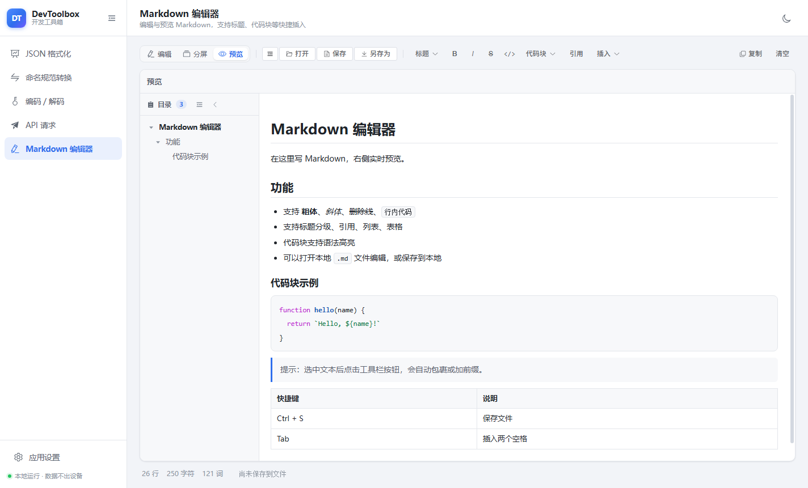

# DevToolbox 开发工具箱

基于 **Electron + Vue 3 + Element Plus** 的跨平台桌面工具集，风格简洁，支持亮色 / 暗色两种主题，所有数据都在本地处理。


## 功能

| 工具 | 说明 |
| --- | --- |
| JSON 格式化 | 校验并格式化 JSON，出错时给出精确到行列的错误位置；结果支持树形折叠查看、复制；超大文件走流式读取 → 流式写出，不在界面渲染 |
| 命名规范转换 | 下划线 / 驼峰 / 中划线 / 点号 / 常量 / 空格 / 首字母大写等常见命名风格互转，支持多行批量转换 |
| 编码 / 解码 | URL、Base64、MD5、SHA-1、SHA-256、HTML 实体、Unicode 转义、Hex、JWT 解析；MD5 支持填入预期摘要做校验 |
| API 请求 | GET/POST/PUT/PATCH/DELETE/HEAD/OPTIONS，请求头（预置常用通用请求头）、鉴权（Bearer / Basic / API Key）、查询参数（与地址栏双向同步）、请求体（JSON / Text / XML / form-urlencoded / form-data 含文件上传 / binary，Content-Type 下拉可选可增删），响应在独立的 Tab 中展示，文本与二进制响应都能导出为文件 |
| 项目与请求管理 | 支持多个项目，在不同项目下分别管理请求记录；左侧请求列表可以折叠成窄条；点击「新请求」新增记录，是否自动保存可在设置里开关（默认关闭），未保存时「保存」按钮显示红点；全部项目与请求都写入本地文件，可导出 / 导入以便迁移到其他机器 |
| Markdown 编辑器 | 编辑与实时预览，工具栏可以折叠；预览模式左侧带目录侧边栏（可按标题层级折叠、可收起成窄条），点击标题即可跳转；插入标题分级、代码块（可选语言、语法高亮）、引用、列表、表格、链接、图片等；可打开 / 保存本地 `.md` 文件 |
| 应用设置 | 切换亮色 / 暗色主题、设置 API 请求自动保存、设置文件下载默认目录、折叠侧边栏、查看运行环境信息 |

## 界面特性

- 左侧导航可折叠：展开时显示图标 + 工具名称，折叠时只显示图标（悬停显示名称）；「应用设置」固定在导航底部
- 一键切换亮色 / 暗色主题，主题、下载目录等设置持久化到用户配置目录
- 侧边栏、窗口尺寸自适应，各工具页面切换时保留状态

| 暗色主题 | API 请求 |
| --- | --- |
|  |  |

| Markdown 编辑器 | 应用设置 |
| --- | --- |
|  |  |

**Markdown 预览目录**：预览模式下左侧按标题层级生成目录，可逐级折叠 / 展开子标题，也可以把整个目录收起成窄条：



**多项目 + 请求记录**：顶部切换项目，左侧是该项目的请求列表（可折叠）；点击「新请求」才会新增一条请求记录，是否自动保存由设置里的「API 请求 → 自动保存」控制（默认关闭），未保存时「保存」按钮上会显示红点。


## 技术栈

- **Electron 45**（主进程 + preload，`contextIsolation: true`、`nodeIntegration: false`），内置 Node.js 24 运行时
- **Vue 3**（`<script setup lang="ts">`）+ **Element Plus**
- **electron-vite**（构建）+ **electron-builder**（打包）
- **Node.js ≥ 24**（开发与打包环境，与 Electron 45 内置的 Node.js、`@types/node` 24.x、CI 保持一致）
- 主进程只使用 Node 内置模块，渲染进程依赖全部被打包进产物，安装包体积更小

## 开发

> 需要 **Node.js 24 或更高版本**（`package.json` 的 `engines` 已声明）；Node 22 及以下版本不再受支持。

```bash
npm install          # 安装依赖（Electron 走 npmmirror 镜像，见 .npmrc）
npm run dev          # 启动开发环境（热更新）
npm run typecheck    # 类型检查（主进程 + 渲染进程）
npm run build        # 类型检查 + 构建产物到 out/
```

## 打包

产物输出到 `release/<version>/`，Windows 实测产物：

| 文件 | 说明 |
| --- | --- |
| `DevToolbox-1.1.3-win-setup.exe` | 多架构安装包（x64 + ARM64 + ia32 合一，自动选择） |
| `DevToolbox-1.1.3-win-x64-setup.exe` | 单架构安装包（同理有 arm64 / ia32） |
| `DevToolbox-1.1.3-win-x64.zip` | 免安装压缩包（同理有 arm64 / ia32） |

```bash
# Windows：x86(ia32) / x64 / ARM64，产出 nsis 安装包与 zip 免安装包
npm run build:win

# 仅打 Windows x64
npm run build:win:x64

# Linux：x64 / ARM64，产出 AppImage 与 deb（需在 Linux / WSL2 / 容器中执行）
npm run build:linux

# Linux ARMv7l
npm run build:linux:armv7l

# 只生成解包目录，便于本地验证
npm run build:unpack
```

> **下载缓存与临时目录**：以上打包命令都会经过 [`scripts/electron-builder.mjs`](scripts/electron-builder.mjs) 调用 electron-builder，把 Electron 二进制缓存与 electron-builder 工具链（nsis / winCodeSign）缓存统一放到项目内的 `.cache/`，构建期的 `TEMP` / `TMP` 指到 `.tmp/`（两者都已被 `.gitignore` 忽略），不写 `%LOCALAPPDATA%`。这样在沙箱、受管终端等目录受限的环境里也能直接打包；打包前脚本还会自动预置 winCodeSign 工具链（跳过 Windows 用不到的 macOS 符号链接），因此普通账户无需管理员权限或「开发者模式」即可打包。缓存可以随时删除，下次打包会重新下载。
> **构建平台**：Windows 目标可以在 Windows 上直接构建；**Linux 产物（AppImage / deb）必须在 Linux 环境构建**，不能直接在 Windows 上生成 —— AppImage 打包需要创建符号链接的权限（Windows 需开启开发者模式或以管理员运行），deb 打包需要 Linux 上的 `fpm` 工具。可选方式：
>
> 1. **GitHub Actions（推荐，无需本地 Linux）**：仓库内置 [.github/workflows/build-linux.yml](.github/workflows/build-linux.yml)，在 Actions 页面手动运行 `build-linux`（或推送 `v*` 标签）即可下载 AppImage / deb 产物（工作流只上传 artifact，不会创建 GitHub Release）；
> 2. **WSL2**：`wsl --install -d Ubuntu` 后，在 WSL 里重新 `npm ci && npm run build:linux`（不要复用 Windows 的 `node_modules`）；
> 3. **Docker / Linux 机器**：挂载源码后在容器内执行同样的命令。
>
> Electron 二进制默认从 npmmirror 下载（`.npmrc` 与 `electron-builder.yml` 已配置），内网环境可自行替换镜像地址；如果下载阶段报缓存目录无写权限，可用 `npm run build:linux -- -c.electronDownload.cache=.cache/electron` 指定缓存位置（注意 `npm run` 后必须加 `--`），详见「常见问题」。

## 目录结构

```
├── src
│   ├── main                  # 主进程
│   │   ├── index.ts          # 应用入口、窗口创建
│   │   ├── ipc.ts            # IPC 接口注册
│   │   ├── store.ts          # 设置持久化
│   │   ├── apiProjects.ts    # API 多项目 / 请求记录持久化（含导入导出、旧数据迁移）
│   │   ├── jsonFile.ts       # 流式 JSON 校验 + 格式化
│   │   ├── httpClient.ts     # HTTP 客户端（含 form-data、重定向、保存响应）
│   │   └── smoke.ts          # 自动化截图（仅 DSH_SMOKE_DIR 时启用）
│   ├── preload               # contextBridge 暴露的 API
│   ├── renderer              # Vue 渲染进程
│   │   ├── src/views         # 各工具页面
│   │   ├── src/components    # 公共组件（JSON 树、分段控件、键值编辑器、侧边栏）
│   │   └── src/utils         # 命名转换、编解码、格式化等纯函数
│   └── shared                # 主进程 / 渲染进程共享的类型与纯逻辑
├── build                     # 应用图标等打包资源
└── electron-builder.yml      # 打包配置（Windows / Linux、多架构）
```

## 说明

- 配置文件（`settings.json`）与 API 请求数据（`api-projects.json`）保存在**安装目录**；若安装目录不可写（例如装到 `Program Files`、Linux AppImage 只读挂载），会自动回退到用户数据目录，设置页「关于」里可以看到实际路径。旧版本的 `api-history.json` 会在首次启动时自动迁移成新结构（原文件保留不删）。
- API 请求的项目与请求记录都在 `api-projects.json` 里，复制该文件到另一台机器的同一位置即可完成迁移；也可以在「API 请求 → 项目管理」里导出 / 导入。导入采用合并策略，不会覆盖本机已有数据。
- API 请求默认**不自动保存**（可在「设置 → API 请求 → 自动保存」开启），修改后需要点击「保存」或按 `Ctrl+S` 才会写入数据文件；切换请求 / 项目前会提示是否保存。
- 响应的「直接展示」模式会把文本内容转换成可读文本；遇到图片、压缩包、office 文档等二进制内容时会提示「二进制响应」，可一键导出为原样文件（文件名优先取 `Content-Disposition`）。超出展示上限的大文件请在「选项 → 响应处理」里改用「保存到文件」。
- JSON 超大文件处理采用自实现的流式解析器：边读边校验、边写出，内存占用与文件大小无关；遇到语法错误会返回精确的行列号与上下文，不会留下半截输出文件。
- MD5 / SHA 是单向散列，界面上只能"计算摘要"和"对比摘要"，不提供所谓"解码"。
- API 请求由主进程发出（不受浏览器同源策略限制），支持忽略自签名证书、跟随重定向、按 `charset` 解码响应。
- 请求记录会原样保存请求头与鉴权信息（含 Token），请勿在共享机器上保存敏感凭据。

## 更新记录

### 1.1.3

- Markdown 编辑器：修复分屏模式下**同步滚动只单向生效**的问题 —— 以前只有滚动编辑区会带动预览区，滚动预览区时编辑区不动；现在两边互相跟随（并打断程序设置 scrollTop 引起的回环）

### 1.1.2

- 整体：设置入口移到左侧导航底部；设置页卡片铺满窗口宽度，右侧不再留白；侧边栏左下角不再显示版本号（版本信息只在「设置 → 关于」里查看）
- 整体：默认窗口放大到 **1440 × 900**（小屏 / 高缩放比时按屏幕可用区域自动收窄，最小 1040 × 660）
- 整体：升级运行时与工具链版本 —— **Electron 30 → 45**（内置 Node.js 20 → **24**）、开发 / 打包环境要求 **Node.js 24+**（`engines.node`、`@types/node` 24.x、GitHub Actions 使用 Node 24）
- API 请求：请求列表改为**可伸缩侧边栏**，一键折叠成窄条（折叠状态会记住）
- API 请求：请求名称输入框移到地址栏上方
- API 请求：响应不再和参数挤在一起，改为和「参数 / 请求头 / 鉴权 / 请求体 / 选项」并列的**独立 Tab**，空间更大
- API 请求：新增「自动保存」开关（设置 → API 请求，默认关闭）。关闭时只有点击「保存」或 `Ctrl+S` 才落盘，切换请求时会先询问是否保存
- API 请求：请求体 `Content-Type` 改为下拉选择，内置常用类型，可直接输入新类型，也可在「管理」里增删（保存在本地设置中）
- API 请求：地址里的查询串会自动解析到「参数」表格，表格里的增删改也会实时同步回地址栏（发送时不会再重复追加参数）
- API 请求：请求头默认预置 `Accept` / `Accept-Language` / `User-Agent` / `Connection` 等通用请求头
- API 请求：支持**导出二进制文件** —— 图片、压缩包、office 文档等非文本响应按原始字节保存；优先使用 `Content-Disposition` 里的文件名，图片可直接预览
- API 请求：修复「请求详情」里「已配置的请求头」一直为空的问题；现在展示实际发出的方法、地址与全部请求头（含自动补充的通用请求头），并可通过 HTTP 版本、请求体类型排查问题
- Markdown 编辑器：工具栏（插入菜单）支持折叠 / 展开
- Markdown 编辑器：预览模式增加目录侧边栏 —— 按标题层级缩进展示，每条标题可单独折叠 / 展开子标题，也可一键全部折叠 / 展开；目录本身还能收起成 34px 窄条，把空间让给正文
- Markdown 编辑器：代码块按钮改为下拉菜单，可选择 JavaScript / TypeScript / Python / Java / Go / Rust / SQL / Shell / JSON 等语言

### 1.1.1

- API 请求：改为**多项目**管理，可在不同项目下分别维护请求记录，项目支持新建 / 重命名 / 删除
- API 请求：新增「新请求」按钮，只有点击后才会创建一条新的请求记录，不再随发送自动产生历史
- API 请求：修改请求后自动保存（停止输入约 0.6 秒写入数据文件，窗口失焦也会立即保存），也可用 `Ctrl+S` 或点击「保存」立即保存；存在未保存修改时「保存」按钮显示红点
- API 请求：所有项目与请求记录统一保存在 `api-projects.json`，支持导出 / 导入，方便迁移到其他机器
- 兼容带 UTF-8 BOM 的数据文件，并自动迁移旧版 `api-history.json` 中的请求记录

## 常见问题

- **安装时提示 `NSIS Error: Error writing temporary file. Make sure your temp folder is valid.`**：这是安装包所在目录被系统策略/安全软件限制导致的 —— 从受限目录（例如受管控的工作区、只读目录、被沙箱接管的路径）启动 NSIS 安装器时，它无法把自身解压到系统临时目录。把 `DevToolbox-*-setup.exe` 复制到普通目录（如 `下载`、`D:\Temp`）后再双击运行即可；也可以直接使用免安装的 `DevToolbox-*-win-*.zip`，解压后运行 `DevToolbox.exe`。
- **Windows 打包报 `winCodeSign` 解压失败（`Cannot create symbolic link` / `客户端没有所需的特权`）**：electron-builder 的工具链压缩包里包含 macOS 符号链接，Windows 上解压它需要「创建符号链接」权限（管理员运行或开启「开发者模式」）。本项目已通过 `scripts/electron-builder.mjs` 在打包前自动把该工具链解压到 `.cache/electron-builder/winCodeSign/winCodeSign-2.6.0` 并跳过 macOS 部分，普通账户无需任何特殊权限；如果手动调用 electron-builder 而没走脚本，仍会报这个错，可按同样思路手动解压一次（或改用 `npm run build:win`）。
- **打包时 `!tempfile: Unable to create temporary file`，紧接着 `Error in macro _Switch on macroline 8` / `Error in macro PAGE_INSTALL_MODE`**：NSIS 编译安装包脚本时要用临时文件（`${Switch}` 依赖 `!tempfile`），若 `TEMP`/`TMP` 指向不可写目录（沙箱、受管终端、只读盘）就会这样失败。项目的打包命令已把构建期 `TEMP`/`TMP` 指到项目内的 `.tmp/`，正常不会再出现；手动调用 electron-builder 时请自行把 `TEMP`/`TMP` 指向可写目录。
- **Windows 打包报 `open ...\AppData\Local\Electron\Cache\xxxx.zip.partN: Access is denied.`，接着 `app-builder.exe process failed ERR_ELECTRON_BUILDER_CANNOT_EXECUTE`**：electron-builder 默认把 Electron 压缩包下到 `%LOCALAPPDATA%\Electron\Cache`、把 nsis / winCodeSign 下到 `%LOCALAPPDATA%\electron-builder\Cache`，在沙箱、受管终端或被安全软件接管的机器上这些目录不可写。本项目已用 `scripts/electron-builder.mjs` 统一把两类缓存改到项目内的 `.cache/`，所以 `npm run build:win` 在这类环境下可直接执行；如果仍报同样的错，说明连项目目录也不可写，请换到普通终端执行。
- **`npm run build:linux` 报 `open ...\*.zip.partN: Access is denied.`**：electron-builder 的下载器写不了 Electron 缓存目录（沙箱、受管终端、杀软拦截时都会这样，不是项目代码问题）。项目的打包命令已经通过 `scripts/electron-builder.mjs` 把缓存放到 `.cache/electron`，正常情况下不会再出现；如果自定义了缓存位置，注意必须是项目内可写的路径：
  ```bash
  # 注意：npm run 后面必须加 --，否则参数会被 npm 自己消费掉
  npm run build:linux -- -c.electronDownload.cache=.cache/electron
  ```
  在沙箱 / 受管终端里，工作区之外的路径（例如 `C:\Workspaces\Cache`、`%LOCALAPPDATA%`、`%TEMP%`）都可能被拒绝写入，此时请使用项目内的相对路径（`.cache/electron`）。注意修好下载后，Windows 仍会在下面的符号链接 / fpm 步骤失败——Windows 本机无法完成 Linux 打包。
- **`npm run build:linux` 报 `symlink ... A required privilege is not held by the client.`**：AppImage 打包需要在 Windows 上创建符号链接，当前账户没有该权限（关闭了「开发者模式」且非管理员）。开启「开发者模式」或以管理员运行可以绕过这一步，但 deb 仍需要 Linux 上的 `fpm`，所以 **Windows 本机无法完整产出 Linux 包**，请改用 GitHub Actions / WSL2 / Docker。
- **`npm run build:linux` 报 `exec: "fpm": executable file not found in %PATH%`**：`deb` 打包依赖 Linux 上的 `fpm`，Windows 没有该工具，请在 Linux / WSL2 / 容器中执行，或使用仓库内置的 GitHub Actions 工作流。
- **`npm run build:linux` 报 `Please specify author 'email' ...`**：`deb` 需要维护者信息，本项目已在 `electron-builder.yml` 的 `linux.maintainer` 中配置；若你改过 `package.json` 的 `author`，注意保留邮箱或同步修改该字段。


