# DevToolbox 开发工具箱

基于 **Electron + Vue 3 + Element Plus** 的跨平台桌面工具集，风格简洁，支持亮色 / 暗色两种主题，所有数据都在本地处理。

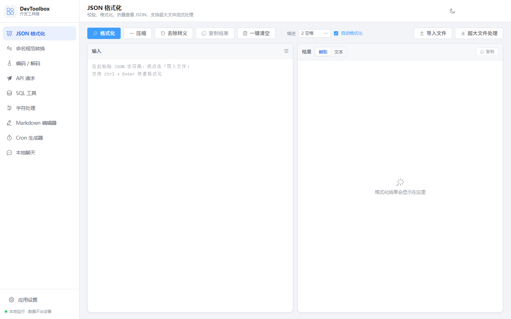

## 功能

| 工具 | 说明 |
| --- | --- |
| JSON 格式化 | 校验并格式化 JSON，出错时给出精确到行列的错误位置；结果支持树形折叠查看、复制；支持一键**去除转义**（把 `\"`、`\\`、`\n`、`\uXXXX` 还原成真实字符，处理二次转义的 JSON）；超大文件走流式读取 → 流式写出，不在界面渲染 |
| 命名规范转换 | 下划线 / 驼峰 / 中划线 / 点号 / 常量 / 空格 / 首字母大写等常见命名风格互转，支持多行批量转换 |
| 编码 / 解码 | URL、Base64、MD5、SHA-1、SHA-256、HTML 实体、Unicode 转义、Hex、JWT 解析；MD5 支持填入预期摘要做校验 |
| API 请求 | GET/POST/PUT/PATCH/DELETE/HEAD/OPTIONS，请求头（预置常用通用请求头）、鉴权（Bearer / Basic / API Key）、查询参数（与地址栏双向同步）、请求体（JSON / Text / XML / form-urlencoded / form-data 含文件上传 / binary，Content-Type 下拉可选可增删），响应在独立的 Tab 中展示；**每个请求各自记住上一次的响应**，切换请求再切回来结果还在；文本与二进制响应都能导出为文件 |
| 项目与请求管理 | 支持多个项目，在不同项目下分别管理请求记录；请求列表支持**多级文件夹**（新建 / 重命名 / 删除子文件夹，删除文件夹会连同里面的请求一起删除，也可以把请求移动到别的文件夹）；列表每行只显示「请求类型 + 接口名称 + 请求结果」，复制 / 删除 / 新建文件夹等操作收在行尾的弹出菜单里；**默认按创建时间排序**，也可以切到**手动排序**拖动调整顺序；列表宽度随窗口自适应（268 ~ 460px）；全部项目、文件夹与请求都写入本地文件，可导出 / 导入以便迁移到其他机器 |
| Markdown 编辑器 | 编辑与实时预览，工具栏可以折叠；预览模式左侧带目录侧边栏（可按标题层级折叠、可收起成窄条、宽度随窗口自适应 210 ~ 360px），点击标题即可跳转；**行首缩进会原样保留**（包括从记事本粘来的 Tab 缩进）；插入标题分级、代码块（可选语言、语法高亮）、引用、列表、表格、链接、图片等，插入后**不会把文档滚动到最后**；内置 **Markdown 语法弹窗**，可按关键字搜索语法并一键插入；**文档内搜索**支持区分大小写、整词、正则，编辑区选中源码、**预览区高亮命中并滚动定位**；打开 / 保存本地 `.md` 文件时会**检测文件是否被其它程序改过**（冲突时可选覆盖保存 / 另存为 / 取消，未修改时自动载入最新内容）；从预览切回编辑会**接着预览所在的位置** |
| Cron 生成器 | 布局为「Cron 表达式 → 常用定时 → 选择时间」，表达式类型切换在表达式的表头，右侧只放最近运行时间；按「秒 / 分 / 时 / 日 / 月 / 周 / 年」逐字段选择时间（每秒 / 范围 / 周期 / 指定，日与周还支持最近工作日、最后一天、最后工作日、第几个星期、最后一个星期），正在编辑的字段会在表达式里高亮；实时生成 **Quartz / Spring / Linux / Node** 四种表达式，选择器固定展示全部字段，当前类型用不到的字段与写法（Linux 的秒、非 Quartz 的年、Linux / Node 的 L / W / #）自动禁用；内置常用定时、按类型区分差异的语法弹窗，并按所选时区展示最近 5 次运行时间（可切换 5 / 10 / 20 次），表达式也可手动编辑后「解析分析」回填选择器 |
| 本地聊天 | 局域网内点对点聊天：手动填对方的 **IP + 端口**加好友并起备注（不填备注就显示对方昵称）；加好友走**好友申请**流程，对方同意后才会出现在列表，申请记录里区分「添加我 / 我添加」并记录同意 / 拒绝结果（结果会回执给发起方，打开「新好友」时自动补发未闭环的申请），可选是否继承已有聊天记录；程序启动即在配置端口监听（默认 45871，可在设置或「我的资料」里改），改昵称 / 头像 / 端口会广播给在线好友，切换好友时自动同步对方资料；好友状态分**在线 / 离线 / 不可达**；支持文字、图片、文件、表情，图片与文件的「打开 / 定位」统一为图标按钮，好友列表可拖动伸缩，聊天记录可搜索；随机生成昵称与头像，也可自己上传；聊天记录、好友与资料都保存在 `chat.json`，附件目录可自定义，方便整体迁移 |
| 应用设置 | 切换亮色 / 暗色主题、设置 API 请求自动保存、设置文件下载默认目录、设置本地聊天端口与聊天文件目录、折叠侧边栏、查看运行环境信息 |

## 界面特性

- 左侧导航可折叠：展开时显示图标 + 工具名称，折叠时只显示图标（悬停显示名称）；「应用设置」固定在导航底部
- 一键切换亮色 / 暗色主题，主题、下载目录等设置持久化到用户配置目录
- 侧边栏、窗口尺寸自适应，各工具页面切换时保留状态

| 暗色主题 | API 请求 |
| --- | --- |
| 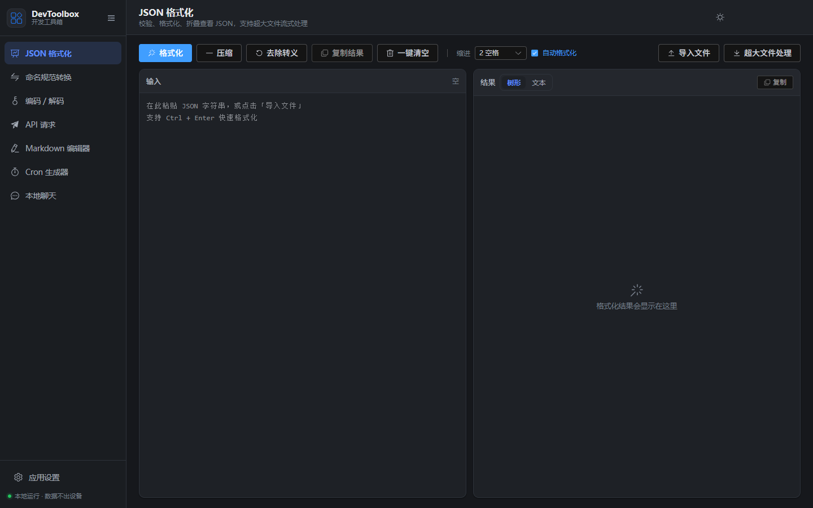 | 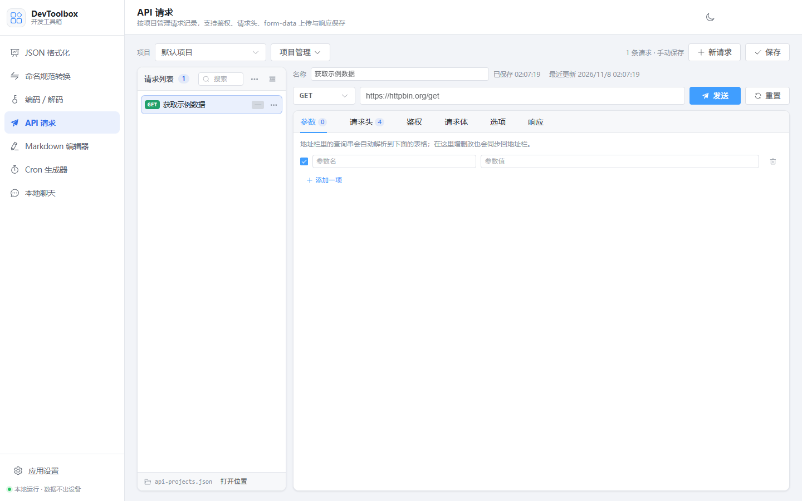 |

| Markdown 编辑器 | Cron 生成器 |
| --- | --- |
| 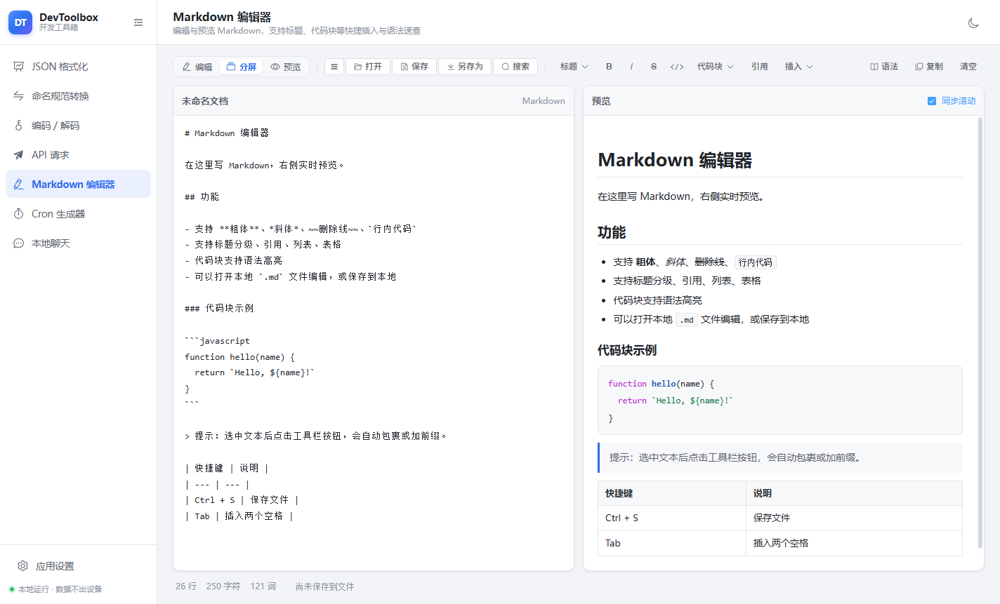 | 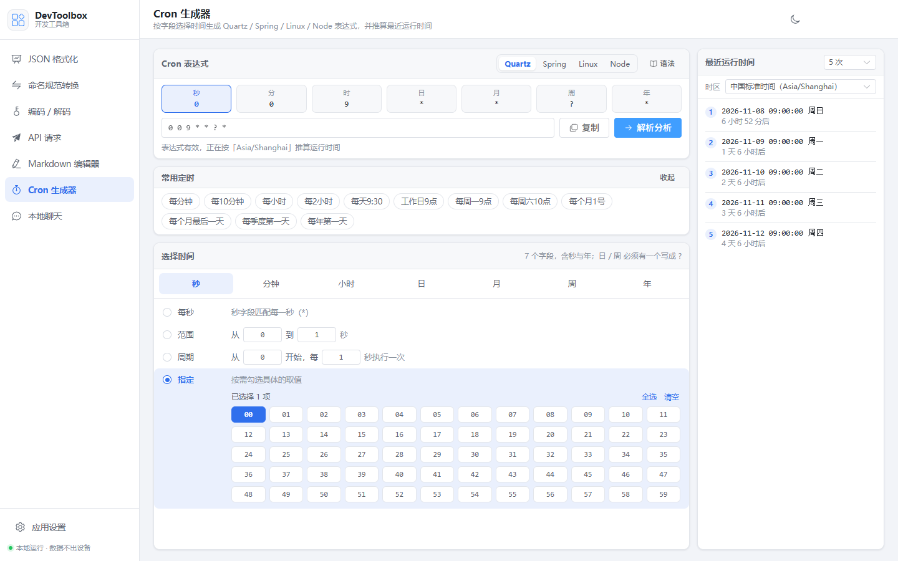 |

| 本地聊天 | 应用设置 |
| --- | --- |
| 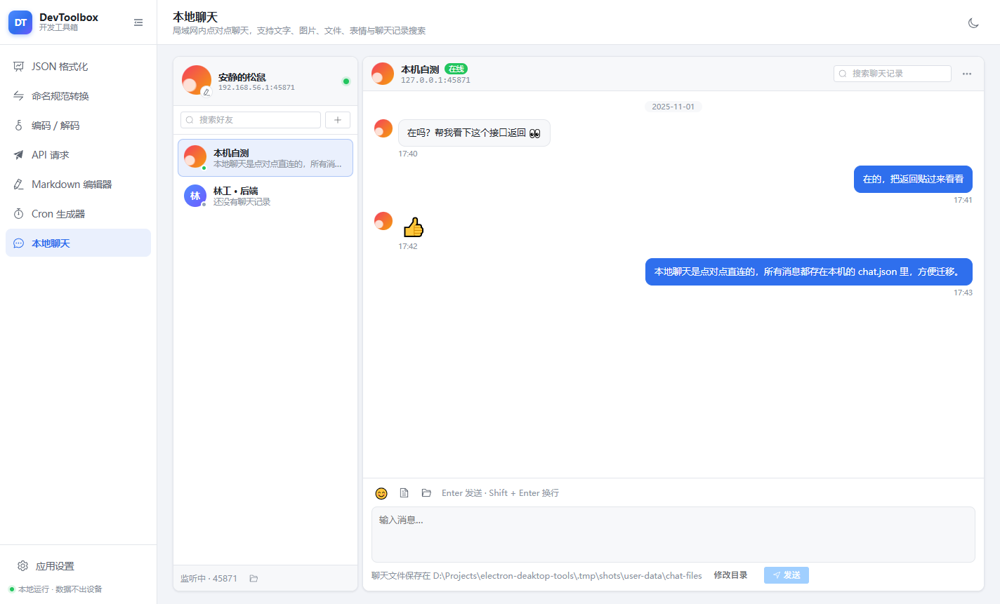 | 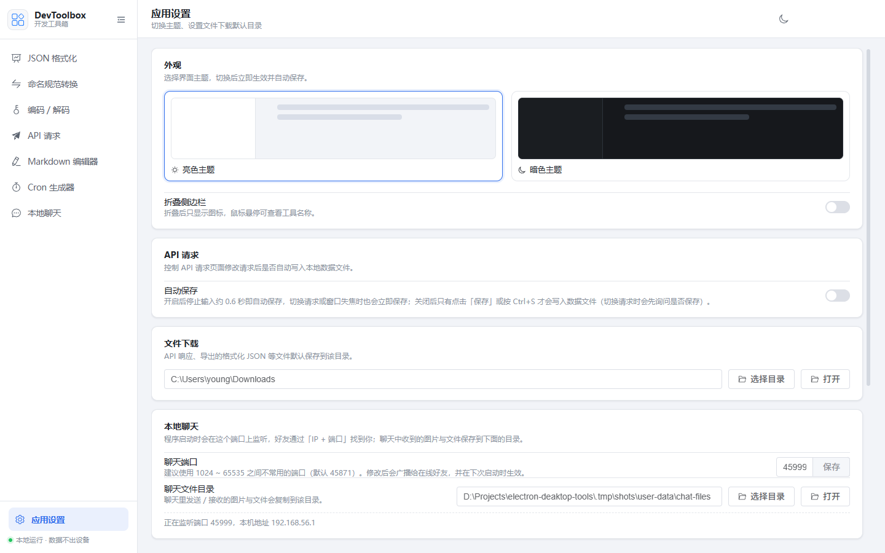 |

**新好友**：加好友改成申请制，对方同意后才会出现在好友列表；申请列表区分「添加我 / 我添加」，并记录同意 / 拒绝的结果，同意前可以选择是否继承已有的聊天记录：

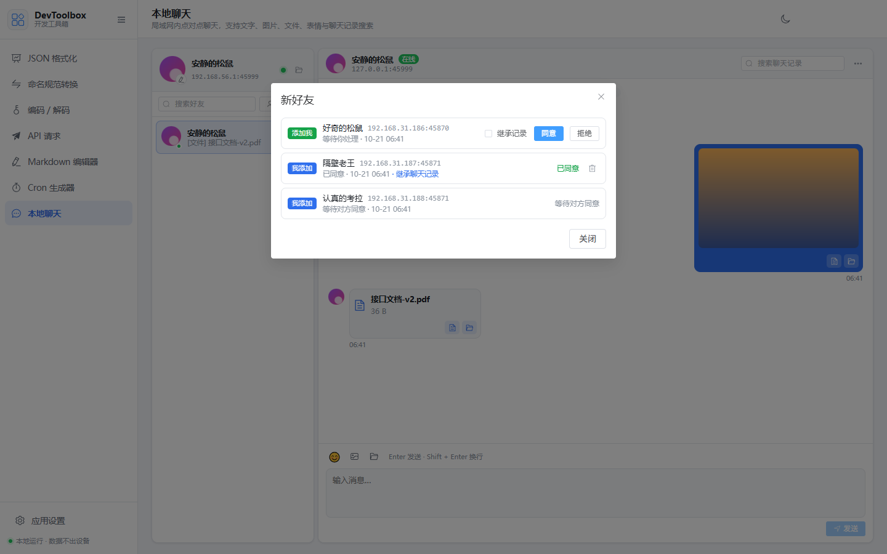

**API 请求列表**：接口按文件夹分组，每行只显示请求类型、接口名称与请求结果，复制 / 删除 / 新建文件夹都在行尾的「⋯」菜单里；删除文件夹会连同里面的请求一起删除：


**Cron 生成器**：自上而下是「Cron 表达式 → 常用定时 → 选择时间」，表达式类型在表达式表头切换，右侧只放最近运行时间；正在编辑的字段会在表达式里高亮。点「语法」可以查各类型的差异、字段取值、符号含义和四种写法的常用示例：

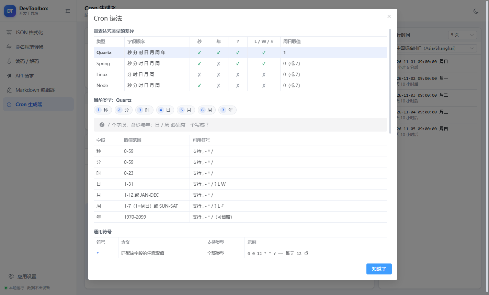

**Markdown 语法弹窗**：按分组列出常用语法，支持关键字搜索，点「插入」即可写到编辑器光标处：

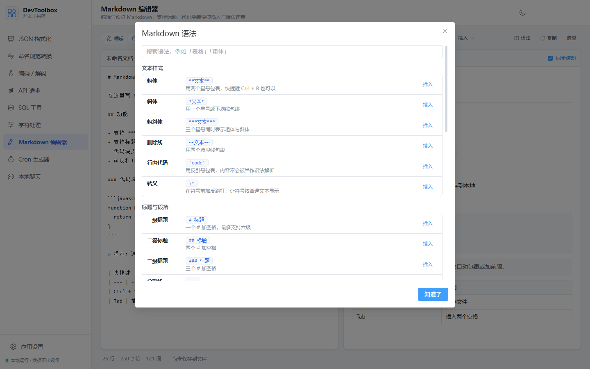

**Markdown 文档内搜索**：编辑 / 分屏 / 预览都能用；编辑区会选中命中文字，预览区高亮所有命中，当前项用更深的底色标出并自动滚动过去：

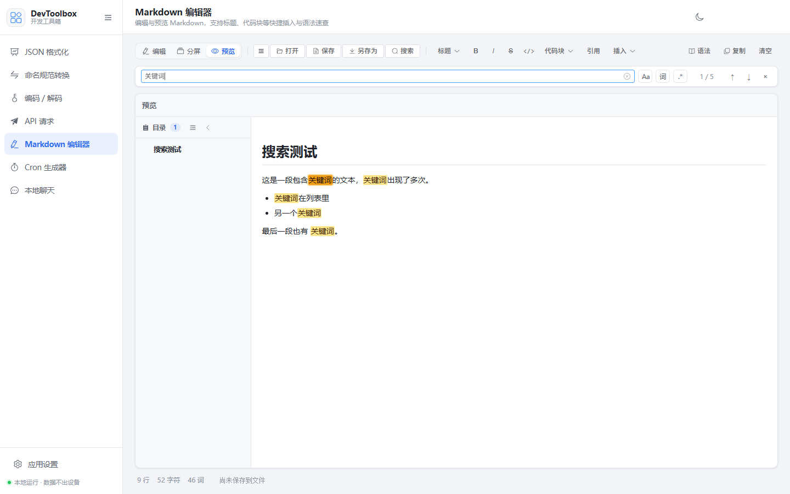

**Markdown 预览目录**：预览模式下左侧按标题层级生成目录，可逐级折叠 / 展开子标题，也可以把整个目录收起成窄条：

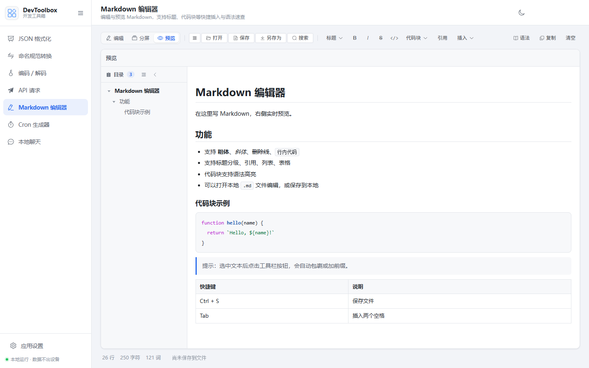

**多项目 + 请求记录**：顶部切换项目，左侧是该项目的请求列表（可折叠）；点击「新请求」才会新增一条请求记录，是否自动保存由设置里的「API 请求 → 自动保存」控制（默认关闭），未保存时「保存」按钮上会显示红点。

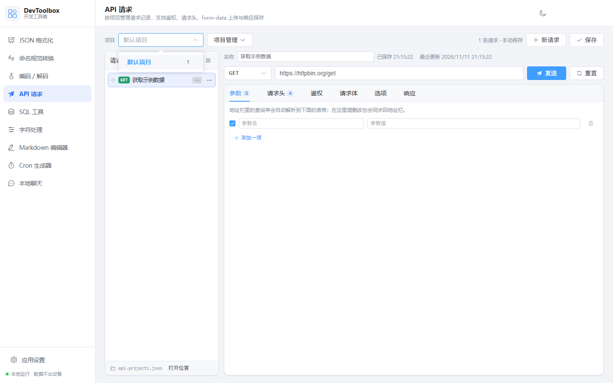

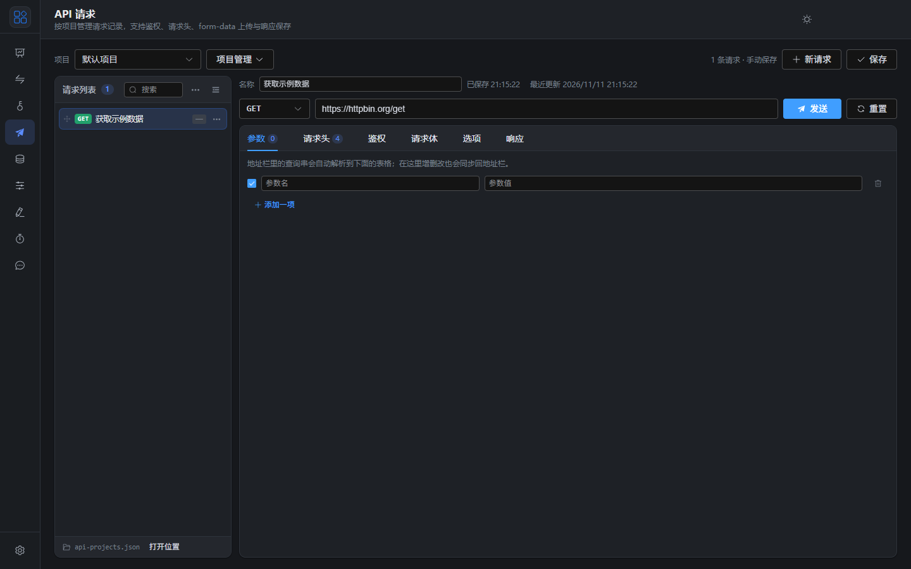

## 技术栈

- **Electron 45**（主进程 + preload，`contextIsolation: true`、`nodeIntegration: false`），内置 Node.js 24 运行时
- **Vue 3**（`<script setup lang="ts">`）+ **Element Plus**
- **electron-vite**（构建）+ **electron-builder**（打包）
- **Node.js ≥ 24**（开发与打包环境，与 Electron 45 内置的 Node.js、`@types/node` 24.x、CI 保持一致）
- 主进程只使用 Node 内置模块，渲染进程依赖全部被打包进产物，安装包体积更小

## 开发

> 需要 **Node.js 24 或更高版本**（`package.json` 的 `engines` 已声明）；Node 22 及以下版本不再受支持。

```bash
npm install          # 安装依赖（Electron 走 npmmirror 镜像，见 .npmrc）
npm run dev          # 启动开发环境（热更新）
npm run typecheck    # 类型检查（主进程 + 渲染进程）
npm run build        # 类型检查 + 构建产物到 out/
```

## 打包

产物输出到 `release/<version>/`，Windows 实测产物：

| 文件 | 说明 |
| --- | --- |
| `DevToolbox-1.3.5-win-setup.exe` | 多架构安装包（x64 + ARM64 + ia32 合一，自动选择） |
| `DevToolbox-1.3.5-win-x64-setup.exe` | 单架构安装包（同理有 arm64 / ia32） |
| `DevToolbox-1.3.5-win-x64.zip` | 免安装压缩包（同理有 arm64 / ia32） |

```bash
# Windows：x86(ia32) / x64 / ARM64，产出 nsis 安装包与 zip 免安装包
npm run build:win

# 仅打 Windows x64
npm run build:win:x64

# Linux：x64 / ARM64，产出 AppImage 与 deb（需在 Linux / WSL2 / 容器中执行）
npm run build:linux

# Linux ARMv7l
npm run build:linux:armv7l

# 只生成解包目录，便于本地验证
npm run build:unpack
```

> **下载缓存与临时目录**：以上打包命令都会经过 [`scripts/electron-builder.mjs`](scripts/electron-builder.mjs) 调用 electron-builder，把 Electron 二进制缓存与 electron-builder 工具链（nsis / winCodeSign）缓存统一放到项目内的 `.cache/`，构建期的 `TEMP` / `TMP` 指到 `.tmp/`（两者都已被 `.gitignore` 忽略），不写 `%LOCALAPPDATA%`。这样在沙箱、受管终端等目录受限的环境里也能直接打包；打包前脚本还会自动预置 winCodeSign 工具链（跳过 Windows 用不到的 macOS 符号链接），因此普通账户无需管理员权限或「开发者模式」即可打包。缓存可以随时删除，下次打包会重新下载。
> **构建平台**：Windows 目标可以在 Windows 上直接构建；**Linux 产物（AppImage / deb）必须在 Linux 环境构建**，不能直接在 Windows 上生成 —— AppImage 打包需要创建符号链接的权限（Windows 需开启开发者模式或以管理员运行），deb 打包需要 Linux 上的 `fpm` 工具。可选方式：
>
> 1. **GitHub Actions（推荐，无需本地 Linux）**：仓库内置 [.github/workflows/build-linux.yml](.github/workflows/build-linux.yml)，在 Actions 页面手动运行 `build-linux`（或推送 `v*` 标签）即可下载 AppImage / deb 产物（工作流只上传 artifact，不会创建 GitHub Release）；
> 2. **WSL2**：`wsl --install -d Ubuntu` 后，在 WSL 里重新 `npm ci && npm run build:linux`（不要复用 Windows 的 `node_modules`）；
> 3. **Docker / Linux 机器**：挂载源码后在容器内执行同样的命令。
>
> Electron 二进制默认从 npmmirror 下载（`.npmrc` 与 `electron-builder.yml` 已配置），内网环境可自行替换镜像地址；如果下载阶段报缓存目录无写权限，可用 `npm run build:linux -- -c.electronDownload.cache=.cache/electron` 指定缓存位置（注意 `npm run` 后必须加 `--`），详见「常见问题」。

## 目录结构

```
├── src
│   ├── main                  # 主进程
│   │   ├── index.ts          # 应用入口、窗口创建
│   │   ├── ipc.ts            # IPC 接口注册
│   │   ├── store.ts          # 设置持久化
│   │   ├── apiProjects.ts    # API 多项目 / 文件夹 / 请求记录持久化（含导入导出、旧数据迁移）
│   │   ├── chat.ts           # 本地聊天（HTTP 服务端 + 好友探测 + 消息与附件）
│   │   ├── jsonFile.ts       # 流式 JSON 校验 + 格式化
│   │   ├── httpClient.ts     # HTTP 客户端（含 form-data、重定向、保存响应）
│   │   └── smoke.ts          # 自动化截图（仅 DSH_SMOKE_DIR 时启用）
│   ├── preload               # contextBridge 暴露的 API
│   ├── renderer              # Vue 渲染进程
│   │   ├── src/views         # 各工具页面
│   │   ├── src/components    # 公共组件（JSON 树、分段控件、键值编辑器、侧边栏、Cron 选择器、语法弹窗）
│   │   └── src/utils         # 命名转换、编解码、Cron 解析、格式化等纯函数
│   └── shared                # 主进程 / 渲染进程共享的类型与纯逻辑
├── build                     # 应用图标等打包资源（icon.svg 是图标源文件，icon.ico / icons 由 scripts/generate-icons.py 打包）
└── electron-builder.yml      # 打包配置（Windows / Linux、多架构）
```

## 说明

- 配置文件（`settings.json`）与 API 请求数据（`api-projects.json`）保存在**安装目录**；若安装目录不可写（例如装到 `Program Files`、Linux AppImage 只读挂载），会自动回退到用户数据目录，设置页「关于」里可以看到实际路径。旧版本的 `api-history.json` 会在首次启动时自动迁移成新结构（原文件保留不删）。
- API 请求的项目与请求记录都在 `api-projects.json` 里，复制该文件到另一台机器的同一位置即可完成迁移；也可以在「API 请求 → 项目管理」里导出 / 导入。导入采用合并策略，不会覆盖本机已有数据。
- API 请求默认**不自动保存**（可在「设置 → API 请求 → 自动保存」开启），修改后需要点击「保存」或按 `Ctrl+S` 才会写入数据文件；切换请求 / 项目前会提示是否保存。
- 响应的「直接展示」模式会把文本内容转换成可读文本；遇到图片、压缩包、office 文档等二进制内容时会提示「二进制响应」，可一键导出为原样文件（文件名优先取 `Content-Disposition`）。超出展示上限的大文件请在「选项 → 响应处理」里改用「保存到文件」。
- JSON 超大文件处理采用自实现的流式解析器：边读边校验、边写出，内存占用与文件大小无关；遇到语法错误会返回精确的行列号与上下文，不会留下半截输出文件。
- MD5 / SHA 是单向散列，界面上只能"计算摘要"和"对比摘要"，不提供所谓"解码"。
- API 请求由主进程发出（不受浏览器同源策略限制），支持忽略自签名证书、跟随重定向、按 `charset` 解码响应。
- 请求记录会原样保存请求头与鉴权信息（含 Token），请勿在共享机器上保存敏感凭据。
- 换应用图标：把新图标导出成 `build/icons/{16,24,32,48,64,128,256,512}x{...}.png`（同时更新 `build/icon.png` 与 `build/icon.svg`），再执行 `python scripts/generate-icons.py` 重新打包 `build/icon.ico`。ICO 里每个尺寸用的是 **BMP(DIB) 帧**（不是 PNG 帧），否则 electron-builder 打包时调用 rcedit 会报 `Reserved header is not 0 or image type is not icon`；脚本写完会自检文件头和尺寸。
- 本地聊天是**点对点直连**：程序启动后在配置端口（默认 45871）监听，好友通过「IP + 端口」找到你，消息不经过任何服务器。要跨机器使用，请确保防火墙允许该端口入站；同一台机器同时开两个实例会争抢端口，第二个实例会在设置里提示端口被占用。
- 聊天数据（好友、消息、自己的资料与附件目录）保存在 `chat.json`，聊天中收发的图片与文件保存在「聊天文件目录」；迁移到另一台机器时把这两样一起复制过去即可。好友状态里的「离线」表示对方 IP 和端口是通的，但对端不是本程序。
- 聊天链路没有做身份校验，适合**可信局域网**内使用，请勿在公网环境开放端口。

## 更新记录

### 1.3.5

- 整体：版本号升级到 **1.3.5**
- 本地聊天：修复**被拒绝之后重新加好友，对方没有产生新的申请记录**的问题 —— 以前按「同一个人」复用上次的处理结果（直接回执拒绝），现在只在**同一条申请**被重复推送时才复用结果，新申请一定会生成新的待处理记录
- 本地聊天：去掉好友列表底部重复的 `IP:PORT`（顶部资料卡里已经有了）；聊天文件目录按钮移到顶部资料卡右侧
- 本地聊天：顶部资料卡的昵称与 `IP:PORT` 两行**行距调大**，更易区分

### 1.3.4

- 整体：版本号升级到 **1.3.4**
- 本地聊天：修复**对方同意 / 拒绝后添加方看不到结果**、同意之后**添加方好友列表里也没出现新好友**的问题 —— 回执里带的是接收方自己的申请 id，添加方对不上记录；现在回执使用发起方那条申请的 id，并且重复推送申请时会把已处理的结果再回执一次（打开「新好友」时会自动补发，兜住"回执丢了"的情况）
- 本地聊天：发送图片按钮换成新的图片图标，颜色与发送文件按钮一致
- 本地聊天：发送按钮移到**输入框右下角**

### 1.3.3

- 整体：版本号升级到 **1.3.3**
- 整体：程序图标颜色换成 **#1e7aff**（图标 SVG 与 `icon.ico` / `icon.png` / `icons/*` 全部重出）；侧边栏左上角的品牌图标也换成了同一个图标
- 整体：**去掉系统标题栏左上角的程序图标与名称**（Windows 下改用自定义标题栏，保留右上角最小化 / 最大化 / 关闭按钮），窗口顶部区域可以直接拖动；程序内左上角的图标与名称保留
- 本地聊天：发送图片按钮换成**图片图标**，颜色与发送文件按钮一致
- 本地聊天：图片 / 文件消息的「打开 / 定位」**只保留图标**，鼠标悬停时才显示文字提示
- 本地聊天：新增**新好友**功能 —— 加好友改为发送申请，对方**同意后才会出现在好友列表**；申请列表用「添加我 / 我添加」区分方向，并记录同意 / 拒绝的结果；被添加时可以勾选「继承已有聊天记录」再同意，不勾选则建立全新记录；添加别人时同样可以选择是否继承
- 本地聊天：好友列表底部原来显示「监听中 · 端口」，现在直接显示 **IP:PORT**，聊天文件目录按钮靠右
- 本地聊天：去掉输入框下方的「聊天文件保存在 …」文字与「修改目录」按钮（目录仍在「应用设置」里改），发送按钮移到工具栏最右侧

### 1.3.2

- 整体：版本号升级到 **1.3.2**
- 整体：应用图标换成新的「工具箱」图标（`build/icon.ico`、`build/icon.png`、`build/icons/*` 全部重新生成，源文件是 `build/icon.svg`）
- API 请求：接口列表**默认按创建时间排序**（新建的排在最上面），不再按更新时间乱跳；新增**手动排序**模式，列表右上角「⋯」里切换，开启后拖动行即可调整同一层级内的顺序，顺序会写进数据文件
- API 请求：左侧接口列表**宽度随窗口变化**（最小 268px、最大 460px），大窗口下不再挤成一窄条
- Markdown 编辑器：修复用工具栏按钮（标题、粗体、斜体、删除线、行内代码、代码块、引用、插入）时**文档跳到最后**的问题 —— 插入后会保持原来的滚动位置
- Markdown 编辑器：预览模式左侧的标题目录**宽度随窗口变化**（最小 210px、最大 360px）
- 本地聊天：添加好友时**不填备注就显示对方昵称**（以前会把 IP 当备注存下来），已经存成 IP 的旧数据在拿到昵称后也会自动改用昵称显示
- 本地聊天：图片与文件消息的「打开 / 定位」按钮**统一成同一套样式**（以前一个是图标、一个是文字）

### 1.3.1

- 整体：版本号升级到 **1.3.1**
- Markdown 编辑器：修复**弹窗底部按钮挤在一起**的问题 —— 全局曾经把相邻按钮的默认间距清掉，现在弹窗与确认框会重新留出间距
- Markdown 编辑器：修复**预览时行首缩进仍然不显示**的问题 —— 渲染前把行首空白换成不换行空格，空格缩进与**从记事本等编辑器粘进来的 Tab 缩进**都能保留；代码块、列表、引用等依赖缩进的语法不受影响
- Markdown 编辑器：**预览模式也支持搜索** —— 搜索框移到工具栏下方的公共位置，编辑 / 分屏 / 预览三种模式都能用；预览里命中的文字会高亮，当前项用更深的底色标出并自动滚动到可视区域

### 1.3.0

- 整体：版本号升级到 **1.3.0**
- 新增**本地聊天**工具：局域网内点对点聊天，手动填对方 IP + 端口加好友（可起备注），启动即在配置端口监听（默认 45871）；支持文字、图片、文件、表情，好友列表可拖动伸缩，聊天记录可搜索；昵称 / 头像 / 端口可改，改完广播给在线好友，切换好友时自动同步对方资料；好友状态分为**在线**（在用本程序）、**离线**（端口通但不是本程序）、**不可达**；首次使用随机生成昵称与头像，也可上传自定义头像；消息、好友与资料都存进 `chat.json`，附件目录可自定义，方便整体迁移
- API 请求：**每个请求各自记住上一次的响应**，切换请求再切回来结果还在（含响应 Tab 的选择）
- API 请求：请求列表支持**多级文件夹**，可以新建 / 重命名 / 删除文件夹，删除文件夹会连同其中（含子文件夹）的请求一起删除；请求也可以通过「移动到文件夹」挪到别处
- API 请求：列表每行只显示**请求类型 + 接口名称 + 请求结果**，复制 / 删除 / 新建文件夹等操作收进行尾的「⋯」弹出菜单
- Markdown 编辑器：预览时**保留行首缩进**（以前 markdown-it 会把行首 1~3 个空格当作缩进吃掉）
- Markdown 编辑器：保存前检查文件是否被其它程序改过，冲突时可选**覆盖保存 / 另存为 / 取消**；打开后没有任何修改时，磁盘上的文件被改动会**自动载入最新内容**
- Markdown 编辑器：新增**文档内搜索**，支持区分大小写、整词匹配、正则表达式，可上一个 / 下一个定位
- Markdown 编辑器：在预览页滚动后切回编辑页，编辑区会**跟着定位到相同位置**
- 应用设置：新增「本地聊天」卡片，可配置聊天端口与聊天文件目录

### 1.2.2

- 整体：版本号升级到 **1.2.2**
- Cron 生成器：界面改为「Cron 表达式 → 常用定时 → 选择时间」自上而下排列，右侧只保留**最近运行时间**并收窄宽度（300px），时间选择区因此更宽敞
- Cron 生成器：**表达式类型**（Quartz / Spring / Linux / Node）移到 Cron 表达式的表头，切换更顺手
- Cron 生成器：选择时间时，表达式里对应的字段会**淡蓝底 + 蓝边高亮**，一眼看出正在编辑哪一段
- Cron 生成器：时间选择器**不再随类型增减字段**，固定展示秒 / 分 / 时 / 日 / 月 / 周 / 年七个字段；当前类型用不到的字段（Linux 无秒、非 Quartz 无年）置灰不可选，悬停有说明；Linux / Node 下依赖 L / W / # 的写法（最近工作日、最后一天、最后工作日、第几个星期、最后一个星期）同样置灰
- Cron 生成器：语法弹窗新增「各表达式类型的差异」对照表（字段顺序、是否支持秒 / 年 / ? / L·W·#、周日取值），字段可用符号、符号支持类型与四种类型的常用示例都会按当前类型高亮 / 置灰，常用示例直接列出 Quartz / Spring / Linux / Node 四种写法便于对照

### 1.2.1

- 整体：版本号升级到 **1.2.1**
- JSON 格式化：新增**去除转义** —— 把 `\"`、`\\`、`\n`、`\t`、`\uXXXX` 等转义还原成真实字符，常用于处理被二次转义的 JSON（例如从日志或代码字符串里复制出来的内容）；结果不是合法 JSON 时会给出提示
- Markdown 编辑器：新增**语法弹窗** —— 按「文本样式 / 标题与段落 / 列表 / 链接与图片 / 引用与代码 / 表格」分组列出常用语法，支持关键字搜索，并可直接点「插入」写入编辑器光标处
- 新增**Cron 生成器**工具：
  - 按「秒 / 分 / 时 / 日 / 月 / 周 / 年」逐字段选择时间，每个字段支持「每秒（每分 / 每时…）」、范围、周期、指定等模式；日与周还支持不指定、最近工作日、最后一天、最后工作日、第几个星期、最后一个星期
  - 实时生成 **Quartz / Spring / Linux / Node** 四种表达式，切换类型后字段会自动增减（Linux 无秒、非 Quartz 无年），并提示方言不支持的写法
  - 表达式可手动编辑后点「解析分析」回填到选择器，也可一键复制
  - 内置 12 个常用定时：每分钟、每10分钟、每小时、每2小时、每天9:30、工作日9点、每周一9点、每周六10点、每个月1号、每个月最后一天、每季度第一天、每年第一天
  - 按所选计算时区展示最近运行时间，默认 5 次，可切换 10 / 20 次
  - 内置 Cron 语法弹窗（字段取值范围、通用符号、常用示例）

### 1.1.3

- Markdown 编辑器：修复分屏模式下**同步滚动只单向生效**的问题 —— 以前只有滚动编辑区会带动预览区，滚动预览区时编辑区不动；现在两边互相跟随（并打断程序设置 scrollTop 引起的回环）

### 1.1.2

- 整体：设置入口移到左侧导航底部；设置页卡片铺满窗口宽度，右侧不再留白；侧边栏左下角不再显示版本号（版本信息只在「设置 → 关于」里查看）
- 整体：默认窗口放大到 **1440 × 900**（小屏 / 高缩放比时按屏幕可用区域自动收窄，最小 1040 × 660）
- 整体：升级运行时与工具链版本 —— **Electron 30 → 45**（内置 Node.js 20 → **24**）、开发 / 打包环境要求 **Node.js 24+**（`engines.node`、`@types/node` 24.x、GitHub Actions 使用 Node 24）
- API 请求：请求列表改为**可伸缩侧边栏**，一键折叠成窄条（折叠状态会记住）
- API 请求：请求名称输入框移到地址栏上方
- API 请求：响应不再和参数挤在一起，改为和「参数 / 请求头 / 鉴权 / 请求体 / 选项」并列的**独立 Tab**，空间更大
- API 请求：新增「自动保存」开关（设置 → API 请求，默认关闭）。关闭时只有点击「保存」或 `Ctrl+S` 才落盘，切换请求时会先询问是否保存
- API 请求：请求体 `Content-Type` 改为下拉选择，内置常用类型，可直接输入新类型，也可在「管理」里增删（保存在本地设置中）
- API 请求：地址里的查询串会自动解析到「参数」表格，表格里的增删改也会实时同步回地址栏（发送时不会再重复追加参数）
- API 请求：请求头默认预置 `Accept` / `Accept-Language` / `User-Agent` / `Connection` 等通用请求头
- API 请求：支持**导出二进制文件** —— 图片、压缩包、office 文档等非文本响应按原始字节保存；优先使用 `Content-Disposition` 里的文件名，图片可直接预览
- API 请求：修复「请求详情」里「已配置的请求头」一直为空的问题；现在展示实际发出的方法、地址与全部请求头（含自动补充的通用请求头），并可通过 HTTP 版本、请求体类型排查问题
- Markdown 编辑器：工具栏（插入菜单）支持折叠 / 展开
- Markdown 编辑器：预览模式增加目录侧边栏 —— 按标题层级缩进展示，每条标题可单独折叠 / 展开子标题，也可一键全部折叠 / 展开；目录本身还能收起成 34px 窄条，把空间让给正文
- Markdown 编辑器：代码块按钮改为下拉菜单，可选择 JavaScript / TypeScript / Python / Java / Go / Rust / SQL / Shell / JSON 等语言

### 1.1.1

- API 请求：改为**多项目**管理，可在不同项目下分别维护请求记录，项目支持新建 / 重命名 / 删除
- API 请求：新增「新请求」按钮，只有点击后才会创建一条新的请求记录，不再随发送自动产生历史
- API 请求：修改请求后自动保存（停止输入约 0.6 秒写入数据文件，窗口失焦也会立即保存），也可用 `Ctrl+S` 或点击「保存」立即保存；存在未保存修改时「保存」按钮显示红点
- API 请求：所有项目与请求记录统一保存在 `api-projects.json`，支持导出 / 导入，方便迁移到其他机器
- 兼容带 UTF-8 BOM 的数据文件，并自动迁移旧版 `api-history.json` 中的请求记录

## 常见问题

- **安装时提示 `NSIS Error: Error writing temporary file. Make sure your temp folder is valid.`**：这是安装包所在目录被系统策略/安全软件限制导致的 —— 从受限目录（例如受管控的工作区、只读目录、被沙箱接管的路径）启动 NSIS 安装器时，它无法把自身解压到系统临时目录。把 `DevToolbox-*-setup.exe` 复制到普通目录（如 `下载`、`D:\Temp`）后再双击运行即可；也可以直接使用免安装的 `DevToolbox-*-win-*.zip`，解压后运行 `DevToolbox.exe`。
- **Windows 打包报 `winCodeSign` 解压失败（`Cannot create symbolic link` / `客户端没有所需的特权`）**：electron-builder 的工具链压缩包里包含 macOS 符号链接，Windows 上解压它需要「创建符号链接」权限（管理员运行或开启「开发者模式」）。本项目已通过 `scripts/electron-builder.mjs` 在打包前自动把该工具链解压到 `.cache/electron-builder/winCodeSign/winCodeSign-2.6.0` 并跳过 macOS 部分，普通账户无需任何特殊权限；如果手动调用 electron-builder 而没走脚本，仍会报这个错，可按同样思路手动解压一次（或改用 `npm run build:win`）。
- **打包时 `!tempfile: Unable to create temporary file`，紧接着 `Error in macro _Switch on macroline 8` / `Error in macro PAGE_INSTALL_MODE`**：NSIS 编译安装包脚本时要用临时文件（`${Switch}` 依赖 `!tempfile`），若 `TEMP`/`TMP` 指向不可写目录（沙箱、受管终端、只读盘）就会这样失败。项目的打包命令已把构建期 `TEMP`/`TMP` 指到项目内的 `.tmp/`，正常不会再出现；手动调用 electron-builder 时请自行把 `TEMP`/`TMP` 指向可写目录。
- **Windows 打包报 `open ...\AppData\Local\Electron\Cache\xxxx.zip.partN: Access is denied.`，接着 `app-builder.exe process failed ERR_ELECTRON_BUILDER_CANNOT_EXECUTE`**：electron-builder 默认把 Electron 压缩包下到 `%LOCALAPPDATA%\Electron\Cache`、把 nsis / winCodeSign 下到 `%LOCALAPPDATA%\electron-builder\Cache`，在沙箱、受管终端或被安全软件接管的机器上这些目录不可写。本项目已用 `scripts/electron-builder.mjs` 统一把两类缓存改到项目内的 `.cache/`，所以 `npm run build:win` 在这类环境下可直接执行；如果仍报同样的错，说明连项目目录也不可写，请换到普通终端执行。
- **`npm run build:linux` 报 `open ...\*.zip.partN: Access is denied.`**：electron-builder 的下载器写不了 Electron 缓存目录（沙箱、受管终端、杀软拦截时都会这样，不是项目代码问题）。项目的打包命令已经通过 `scripts/electron-builder.mjs` 把缓存放到 `.cache/electron`，正常情况下不会再出现；如果自定义了缓存位置，注意必须是项目内可写的路径：
  ```bash
  # 注意：npm run 后面必须加 --，否则参数会被 npm 自己消费掉
  npm run build:linux -- -c.electronDownload.cache=.cache/electron
  ```
  在沙箱 / 受管终端里，工作区之外的路径（例如 `C:\Workspaces\Cache`、`%LOCALAPPDATA%`、`%TEMP%`）都可能被拒绝写入，此时请使用项目内的相对路径（`.cache/electron`）。注意修好下载后，Windows 仍会在下面的符号链接 / fpm 步骤失败——Windows 本机无法完成 Linux 打包。
- **`npm run build:linux` 报 `symlink ... A required privilege is not held by the client.`**：AppImage 打包需要在 Windows 上创建符号链接，当前账户没有该权限（关闭了「开发者模式」且非管理员）。开启「开发者模式」或以管理员运行可以绕过这一步，但 deb 仍需要 Linux 上的 `fpm`，所以 **Windows 本机无法完整产出 Linux 包**，请改用 GitHub Actions / WSL2 / Docker。
- **`npm run build:linux` 报 `exec: "fpm": executable file not found in %PATH%`**：`deb` 打包依赖 Linux 上的 `fpm`，Windows 没有该工具，请在 Linux / WSL2 / 容器中执行，或使用仓库内置的 GitHub Actions 工作流。
- **`npm run build:linux` 报 `Please specify author 'email' ...`**：`deb` 需要维护者信息，本项目已在 `electron-builder.yml` 的 `linux.maintainer` 中配置；若你改过 `package.json` 的 `author`，注意保留邮箱或同步修改该字段。


