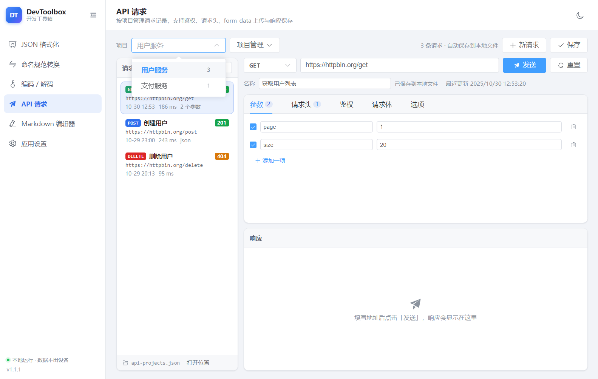
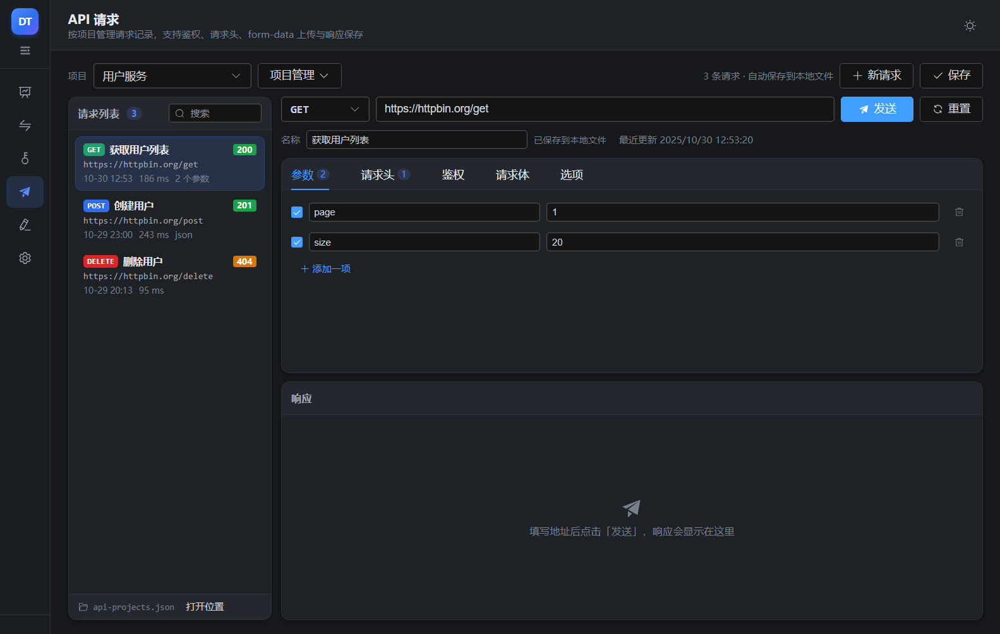

# DevToolbox 开发工具箱

基于 **Electron + Vue 3 + Element Plus** 的跨平台桌面工具集，风格简洁，支持亮色 / 暗色两种主题，所有数据都在本地处理。


## 功能

| 工具 | 说明 |
| --- | --- |
| JSON 格式化 | 校验并格式化 JSON，出错时给出精确到行列的错误位置；结果支持树形折叠查看、复制；超大文件走流式读取 → 流式写出，不在界面渲染 |
| 命名规范转换 | 下划线 / 驼峰 / 中划线 / 点号 / 常量 / 空格 / 首字母大写等常见命名风格互转，支持多行批量转换 |
| 编码 / 解码 | URL、Base64、MD5、SHA-1、SHA-256、HTML 实体、Unicode 转义、Hex、JWT 解析；MD5 支持填入预期摘要做校验 |
| API 请求 | GET/POST/PUT/PATCH/DELETE/HEAD/OPTIONS，请求头、鉴权（Bearer / Basic / API Key）、查询参数、请求体（JSON / Text / XML / form-urlencoded / form-data 含文件上传 / binary），响应可展示或直接保存到文件 |
| 项目与请求管理 | 支持多个项目，在不同项目下分别管理请求记录；点击「新请求」新增记录，修改后自动保存，未保存时「保存」按钮显示红点；全部项目与请求都写入本地文件，可导出 / 导入以便迁移到其他机器 |
| Markdown 编辑器 | 编辑与实时预览，插入标题分级、代码块（语法高亮）、引用、列表、表格、链接、图片等；可打开 / 保存本地 `.md` 文件 |
| 应用设置 | 切换亮色 / 暗色主题、设置文件下载默认目录、折叠侧边栏、查看运行环境信息 |

## 界面特性

- 左侧导航可折叠：展开时显示图标 + 工具名称，折叠时只显示图标（悬停显示名称）
- 一键切换亮色 / 暗色主题，主题、下载目录等设置持久化到用户配置目录
- 侧边栏、窗口尺寸自适应，各工具页面切换时保留状态

| 暗色主题 | API 请求 |
| --- | --- |
|  |  |

| Markdown 编辑器 | 应用设置 |
| --- | --- |
|  |  |

**多项目 + 请求记录**：顶部切换项目，左侧是该项目的请求列表；点击「新请求」才会新增一条请求记录，改动会自动保存，未保存时「保存」按钮上会显示红点。





## 技术栈

- **Electron 30**（主进程 + preload，`contextIsolation: true`、`nodeIntegration: false`）
- **Vue 3**（`<script setup lang="ts">`）+ **Element Plus**
- **electron-vite**（构建）+ **electron-builder**（打包）
- 主进程只使用 Node 内置模块，渲染进程依赖全部被打包进产物，安装包体积更小

## 开发

```bash
npm install          # 安装依赖（Electron 走 npmmirror 镜像，见 .npmrc）
npm run dev          # 启动开发环境（热更新）
npm run typecheck    # 类型检查（主进程 + 渲染进程）
npm run build        # 类型检查 + 构建产物到 out/
```

## 打包

产物输出到 `release/<version>/`，Windows 实测产物：

| 文件 | 说明 |
| --- | --- |
| `DevToolbox-1.1.1-win-setup.exe` | 多架构安装包（x64 + ARM64 + ia32 合一，自动选择） |
| `DevToolbox-1.1.1-win-x64-setup.exe` | 单架构安装包（同理有 arm64 / ia32） |
| `DevToolbox-1.1.1-win-x64.zip` | 免安装压缩包（同理有 arm64 / ia32） |

```bash
# Windows：x86(ia32) / x64 / ARM64，产出 nsis 安装包与 zip 免安装包
npm run build:win

# 仅打 Windows x64
npm run build:win:x64

# Linux：x64 / ARM64，产出 AppImage 与 deb（需在 Linux / WSL2 / 容器中执行）
npm run build:linux

# Linux ARMv7l
npm run build:linux:armv7l

# 只生成解包目录，便于本地验证
npm run build:unpack
```

> **构建平台**：Windows 目标可以在 Windows 上直接构建；**Linux 产物（AppImage / deb）必须在 Linux 环境构建**，不能直接在 Windows 上生成 —— AppImage 打包需要创建符号链接的权限（Windows 需开启开发者模式或以管理员运行），deb 打包需要 Linux 上的 `fpm` 工具。可选方式：
>
> 1. **GitHub Actions（推荐，无需本地 Linux）**：仓库内置 [.github/workflows/build-linux.yml](.github/workflows/build-linux.yml)，在 Actions 页面手动运行 `build-linux`（或推送 `v*` 标签）即可下载 AppImage / deb 产物（工作流只上传 artifact，不会创建 GitHub Release）；
> 2. **WSL2**：`wsl --install -d Ubuntu` 后，在 WSL 里重新 `npm ci && npm run build:linux`（不要复用 Windows 的 `node_modules`）；
> 3. **Docker / Linux 机器**：挂载源码后在容器内执行同样的命令。
>
> Electron 二进制默认从 npmmirror 下载（`.npmrc` 与 `electron-builder.yml` 已配置），内网环境可自行替换镜像地址；如果下载阶段报缓存目录无写权限，可用 `npm run build:linux -- -c.electronDownload.cache=.cache/electron` 指定缓存位置（注意 `npm run` 后必须加 `--`），详见「常见问题」。

## 目录结构

```
├── src
│   ├── main                  # 主进程
│   │   ├── index.ts          # 应用入口、窗口创建
│   │   ├── ipc.ts            # IPC 接口注册
│   │   ├── store.ts          # 设置持久化
│   │   ├── apiProjects.ts    # API 多项目 / 请求记录持久化（含导入导出、旧数据迁移）
│   │   ├── jsonFile.ts       # 流式 JSON 校验 + 格式化
│   │   ├── httpClient.ts     # HTTP 客户端（含 form-data、重定向、保存响应）
│   │   └── smoke.ts          # 自动化截图（仅 DSH_SMOKE_DIR 时启用）
│   ├── preload               # contextBridge 暴露的 API
│   ├── renderer              # Vue 渲染进程
│   │   ├── src/views         # 各工具页面
│   │   ├── src/components    # 公共组件（JSON 树、分段控件、键值编辑器、侧边栏）
│   │   └── src/utils         # 命名转换、编解码、格式化等纯函数
│   └── shared                # 主进程 / 渲染进程共享的类型与纯逻辑
├── build                     # 应用图标等打包资源
└── electron-builder.yml      # 打包配置（Windows / Linux、多架构）
```

## 说明

- 配置文件（`settings.json`）与 API 请求数据（`api-projects.json`）保存在**安装目录**；若安装目录不可写（例如装到 `Program Files`、Linux AppImage 只读挂载），会自动回退到用户数据目录，设置页「关于」里可以看到实际路径。旧版本的 `api-history.json` 会在首次启动时自动迁移成新结构（原文件保留不删）。
- API 请求的项目与请求记录都在 `api-projects.json` 里，复制该文件到另一台机器的同一位置即可完成迁移；也可以在「API 请求 → 项目管理」里导出 / 导入。导入采用合并策略，不会覆盖本机已有数据。
- JSON 超大文件处理采用自实现的流式解析器：边读边校验、边写出，内存占用与文件大小无关；遇到语法错误会返回精确的行列号与上下文，不会留下半截输出文件。
- MD5 / SHA 是单向散列，界面上只能"计算摘要"和"对比摘要"，不提供所谓"解码"。
- API 请求由主进程发出（不受浏览器同源策略限制），支持忽略自签名证书、跟随重定向、按 `charset` 解码响应。
- 请求记录会原样保存请求头与鉴权信息（含 Token），请勿在共享机器上保存敏感凭据。

## 更新记录

### 1.1.1

- API 请求：改为**多项目**管理，可在不同项目下分别维护请求记录，项目支持新建 / 重命名 / 删除
- API 请求：新增「新请求」按钮，只有点击后才会创建一条新的请求记录，不再随发送自动产生历史
- API 请求：修改请求后自动保存（停止输入约 0.6 秒写入数据文件，窗口失焦也会立即保存），也可用 `Ctrl+S` 或点击「保存」立即保存；存在未保存修改时「保存」按钮显示红点
- API 请求：所有项目与请求记录统一保存在 `api-projects.json`，支持导出 / 导入，方便迁移到其他机器
- 兼容带 UTF-8 BOM 的数据文件，并自动迁移旧版 `api-history.json` 中的请求记录

## 常见问题

- **安装时提示 `NSIS Error: Error writing temporary file. Make sure your temp folder is valid.`**：这是安装包所在目录被系统策略/安全软件限制导致的 —— 从受限目录（例如受管控的工作区、只读目录、被沙箱接管的路径）启动 NSIS 安装器时，它无法把自身解压到系统临时目录。把 `DevToolbox-*-setup.exe` 复制到普通目录（如 `下载`、`D:\Temp`）后再双击运行即可；也可以直接使用免安装的 `DevToolbox-*-win-*.zip`，解压后运行 `DevToolbox.exe`。
- **Windows 打包报 `winCodeSign` 解压失败（`Cannot create symbolic link`）**：electron-builder 的工具链压缩包里包含 macOS 符号链接，Windows 上需要"创建符号链接"权限（以管理员运行，或在系统设置中开启"开发者模式"）。也可以先手动解压一次该工具链到 `ELECTRON_BUILDER_CACHE` 指向的 `winCodeSign/winCodeSign-2.6.0` 目录，再重新执行打包命令。
- **打包时 `!tempfile: Unable to create temporary file`**：NSIS 需要可写的临时目录，请确保 `TEMP`/`TMP` 指向可写路径。
- **`npm run build:linux` 报 `open ...\*.zip.partN: Access is denied.`**：electron-builder 的下载器写不了 Electron 缓存目录（沙箱、受管终端、杀软拦截时都会这样，不是项目代码问题）。换到普通终端执行，或把缓存指到一个确实可写的位置：
  ```bash
  # 注意：npm run 后面必须加 --，否则参数会被 npm 自己消费掉
  npm run build:linux -- -c.electronDownload.cache=.cache/electron
  ```
  在沙箱 / 受管终端里，工作区之外的路径（例如 `C:\Workspaces\Cache`、`%LOCALAPPDATA%`、`%TEMP%`）都可能被拒绝写入，此时请使用项目内的相对路径（`.cache/electron`）。注意修好下载后，Windows 仍会在下面的符号链接 / fpm 步骤失败——Windows 本机无法完成 Linux 打包。
- **`npm run build:linux` 报 `symlink ... A required privilege is not held by the client.`**：AppImage 打包需要在 Windows 上创建符号链接，当前账户没有该权限（关闭了「开发者模式」且非管理员）。开启「开发者模式」或以管理员运行可以绕过这一步，但 deb 仍需要 Linux 上的 `fpm`，所以 **Windows 本机无法完整产出 Linux 包**，请改用 GitHub Actions / WSL2 / Docker。
- **`npm run build:linux` 报 `exec: "fpm": executable file not found in %PATH%`**：`deb` 打包依赖 Linux 上的 `fpm`，Windows 没有该工具，请在 Linux / WSL2 / 容器中执行，或使用仓库内置的 GitHub Actions 工作流。
- **`npm run build:linux` 报 `Please specify author 'email' ...`**：`deb` 需要维护者信息，本项目已在 `electron-builder.yml` 的 `linux.maintainer` 中配置；若你改过 `package.json` 的 `author`，注意保留邮箱或同步修改该字段。


