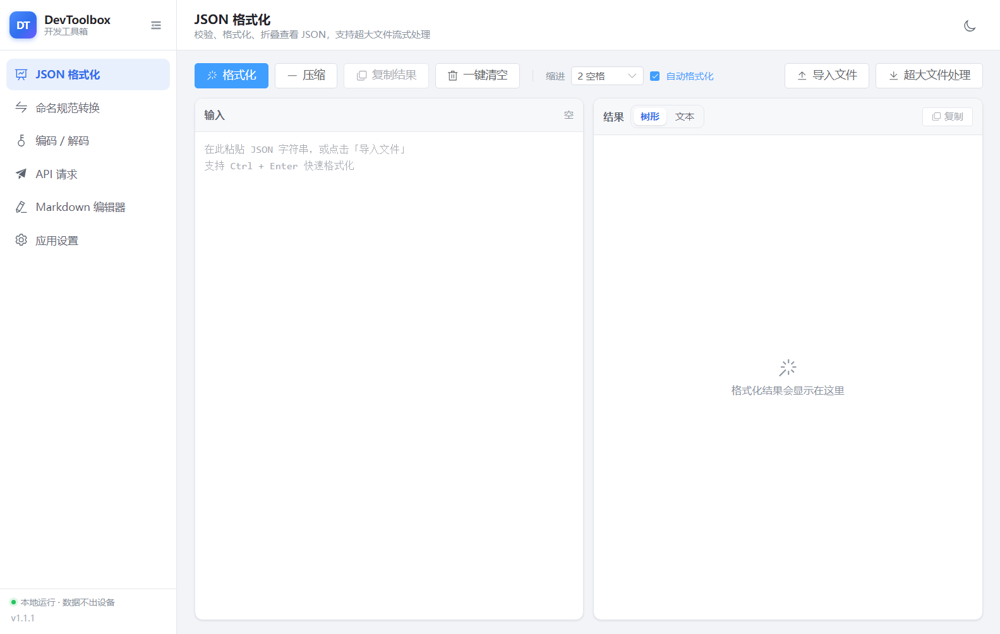
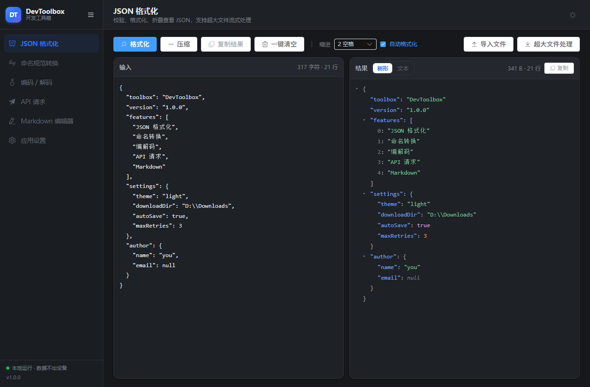
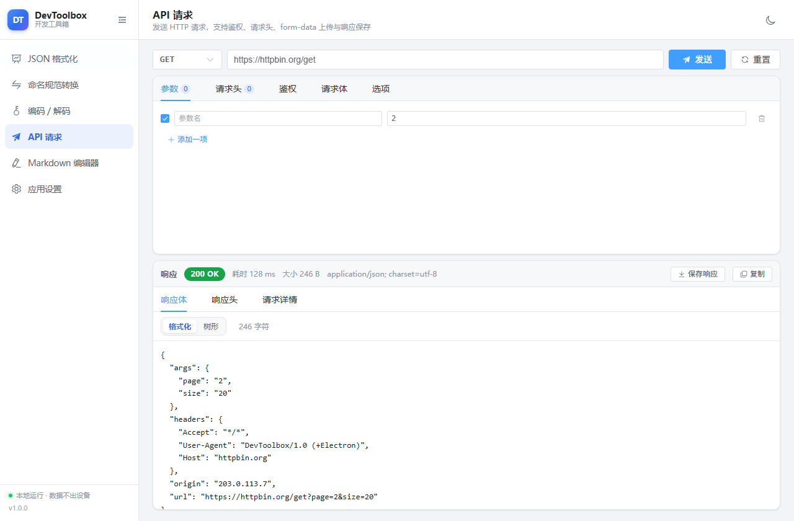
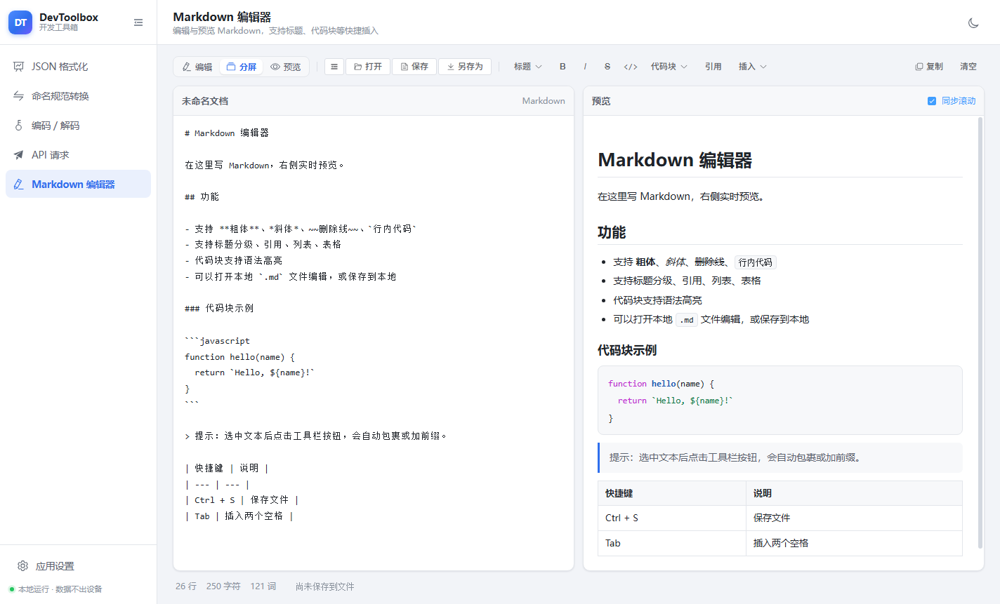
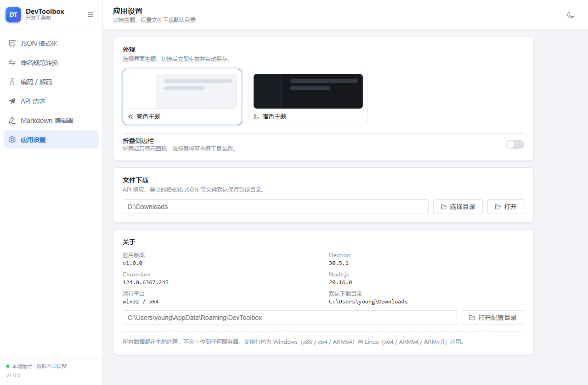

# DevToolbox 开发工具箱

基于 **Electron + Vue 3 + Element Plus** 的跨平台桌面工具集，风格简洁，支持亮色 / 暗色两种主题，所有数据都在本地处理。



## 功能

| 工具 | 说明 |
| --- | --- |
| JSON 格式化 | 校验并格式化 JSON，出错时给出精确到行列的错误位置；结果支持树形折叠查看、复制；超大文件走流式读取 → 流式写出，不在界面渲染 |
| 命名规范转换 | 下划线 / 驼峰 / 中划线 / 点号 / 常量 / 空格 / 首字母大写等常见命名风格互转，支持多行批量转换 |
| 编码 / 解码 | URL、Base64、MD5、SHA-1、SHA-256、HTML 实体、Unicode 转义、Hex、JWT 解析；MD5 支持填入预期摘要做校验 |
| API 请求 | GET/POST/PUT/PATCH/DELETE/HEAD/OPTIONS，请求头、鉴权（Bearer / Basic / API Key）、查询参数、请求体（JSON / Text / XML / form-urlencoded / form-data 含文件上传 / binary），响应可展示或直接保存到文件 |
| Markdown 编辑器 | 编辑与实时预览，插入标题分级、代码块（语法高亮）、引用、列表、表格、链接、图片等；可打开 / 保存本地 `.md` 文件 |
| 应用设置 | 切换亮色 / 暗色主题、设置文件下载默认目录、折叠侧边栏、查看运行环境信息 |

## 界面特性

- 左侧导航可折叠：展开时显示图标 + 工具名称，折叠时只显示图标（悬停显示名称）
- 一键切换亮色 / 暗色主题，主题、下载目录等设置持久化到用户配置目录
- 侧边栏、窗口尺寸自适应，各工具页面切换时保留状态

| 暗色主题 | API 请求 |
| --- | --- |
|  |  |

| Markdown 编辑器 | 应用设置 |
| --- | --- |
|  |  |

## 技术栈

- **Electron 30**（主进程 + preload，`contextIsolation: true`、`nodeIntegration: false`）
- **Vue 3**（`<script setup lang="ts">`）+ **Element Plus**
- **electron-vite**（构建）+ **electron-builder**（打包）
- 主进程只使用 Node 内置模块，渲染进程依赖全部被打包进产物，安装包体积更小

## 开发

```bash
npm install          # 安装依赖（Electron 走 npmmirror 镜像，见 .npmrc）
npm run dev          # 启动开发环境（热更新）
npm run typecheck    # 类型检查（主进程 + 渲染进程）
npm run build        # 类型检查 + 构建产物到 out/
```

## 打包

产物输出到 `release/<version>/`，Windows 实测产物：

| 文件 | 说明 |
| --- | --- |
| `DevToolbox-1.0.0-win-setup.exe` | 多架构安装包（x64 + ARM64 + ia32 合一，自动选择） |
| `DevToolbox-1.0.0-win-x64-setup.exe` | 单架构安装包（同理有 arm64 / ia32） |
| `DevToolbox-1.0.0-win-x64.zip` | 免安装压缩包（同理有 arm64 / ia32） |

```bash
# Windows：x86(ia32) / x64 / ARM64，产出 nsis 安装包与 zip 免安装包
npm run build:win

# 仅打 Windows x64
npm run build:win:x64

# Linux：x64 / ARM64，产出 AppImage 与 deb
npm run build:linux

# Linux ARMv7l
npm run build:linux:armv7l

# 只生成解包目录，便于本地验证
npm run build:unpack
```

> 跨平台打包说明：Windows 目标可以在 Windows 上直接构建；Linux 的 `deb` 需要额外工具链，建议在 Linux（或容器）中执行 `npm run build:linux`。Electron 二进制默认从 npmmirror 下载（`.npmrc` 已配置），内网环境可自行替换镜像地址。

## 目录结构

```
├── src
│   ├── main                  # 主进程
│   │   ├── index.ts          # 应用入口、窗口创建
│   │   ├── ipc.ts            # IPC 接口注册
│   │   ├── store.ts          # 设置持久化
│   │   ├── jsonFile.ts       # 流式 JSON 校验 + 格式化
│   │   ├── httpClient.ts     # HTTP 客户端（含 form-data、重定向、保存响应）
│   │   └── smoke.ts          # 自动化截图（仅 DSH_SMOKE_DIR 时启用）
│   ├── preload               # contextBridge 暴露的 API
│   ├── renderer              # Vue 渲染进程
│   │   ├── src/views         # 各工具页面
│   │   ├── src/components    # 公共组件（JSON 树、分段控件、键值编辑器、侧边栏）
│   │   └── src/utils         # 命名转换、编解码、格式化等纯函数
│   └── shared                # 主进程 / 渲染进程共享的类型与纯逻辑
├── build                     # 应用图标等打包资源
└── electron-builder.yml      # 打包配置（Windows / Linux、多架构）
```

## 说明

- JSON 超大文件处理采用自实现的流式解析器：边读边校验、边写出，内存占用与文件大小无关；遇到语法错误会返回精确的行列号与上下文，不会留下半截输出文件。
- MD5 / SHA 是单向散列，界面上只能"计算摘要"和"对比摘要"，不提供所谓"解码"。
- API 请求由主进程发出（不受浏览器同源策略限制），支持忽略自签名证书、跟随重定向、按 `charset` 解码响应。

## 常见问题

- **Windows 打包报 `winCodeSign` 解压失败（`Cannot create symbolic link`）**：electron-builder 的工具链压缩包里包含 macOS 符号链接，Windows 上需要"创建符号链接"权限（以管理员运行，或在系统设置中开启"开发者模式"）。也可以先手动解压一次该工具链到 `ELECTRON_BUILDER_CACHE` 指向的 `winCodeSign/winCodeSign-2.6.0` 目录，再重新执行打包命令。
- **打包时 `!tempfile: Unable to create temporary file`**：NSIS 需要可写的临时目录，请确保 `TEMP`/`TMP` 指向可写路径。
- **`npm run build:linux` 在 Windows 上失败**：Linux 的 `deb`/`AppImage` 需要 Linux 工具链，请在 Linux 或容器中执行。

